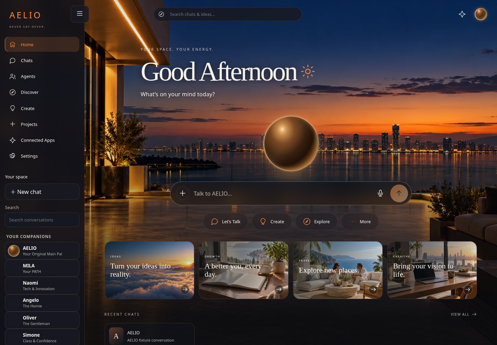

## AELIO 1.0.12 main promotion approved — 2026-10-31

The owner explicitly approved pushing the reviewed messaging, Native Brain, image-routing and Orb Plaza iteration to AELIO main. This supersedes earlier local-only restrictions for this reviewed delta only. Push main only; remote migration and PATHD remain unchanged. Normal Git-triggered builds may run; no manual deployment, production SQL, provider activation, pricing/secret/settings changes or expansion of other AUREVIA destinations is authorized. SQL15's selected-fragment error was diagnosed and the full 146-line script rechecked/provided; successful owner application of SQL14/15/16 is not confirmed here. Live image generation/editing and hosted deployment/Auth verification remain outstanding. Do not turn fixture results into operational claims or treat this promotion as proof of cinematic-reference fidelity.

---

## Current 1.0.12 local review — messaging, Native Brain, images and Orb Plaza

Latest requests are implemented locally on migration, based on main 3405bbf. Do not push even migration, merge main, deploy, run production SQL or activate provider/pricing settings without explicit authorization. Earlier approval covered 1.0.11 only. PATHD is unchanged. Exactly three primary environments (AELIO, Dreambox, Native Brain); AUREVIA is a destination and Studio Brain is inside Native Brain only. Preserve fixed companion identities/portraits, separate per-chat histories/themes, drafts, original cinematic homepage via More and all existing integrations.

Studio requires confirmed server-verified jaja@vybr8.live PLUS the canonical founder role PLUS aal2; never grant/link by email or client metadata. SQL15/16 are new owner-reviewed migrations, default image pricing OFF; no production SQL applied. SQL13 is reported applied and SQL14's execution is unconfirmed. Image routing reuses existing provider keys/storage/credit systems, with one funding source, exact confirmations and refunds. Live generation/editing is BLOCKED here, not operationally verified. Orb Plaza now uses the same scene for cinema/walking, but its cinematic fidelity is NOT approved; do not expand destinations before review. Native tools expose only real configured access; never fabricate public metrics, event counts, trained skills or marketplace values. See docs/releases/AELIO_v1.0.12_REVIEW.md, config/V1_0_12_IMAGES.md and docs/aurevia/ORB_PLAZA_VISUAL_REVIEW.md for scope/evidence/limitations. New ZIP deliveries must remain immutable with at most 100 files per part.

---

## AUREVIA Phase 1 main promotion approved — 2026-10-31

The owner explicitly authorized pushing the reviewed AELIO 1.0.11 AUREVIA Phase 1 update to main. This supersedes the local-only review restriction for this completed delta. Push main only; leave remote migration and PATHD unchanged. Existing Git-triggered builds may run; no manual deployment, production SQL, provider activation, settings or secrets changes are authorized. SQL14 has been supplied to the owner but application is not confirmed; residence/meeting persistence remains unavailable until applied. Preserve the documented distinction between approved 2D concepts, early procedural 3D, fixture-tested Chat continuity and future University/court/valuation/rigged-avatar features. Hosted deployment/inference and provider cost savings remain unverified.

---

## AUREVIA Phase 1 local review — 2026-10-31

Reviewed AELIO 1.0.10 was promoted to main at 2ecfae8 and reviewed PATHD 0.1.6 at 8cbc6c4 under explicit user approval. Remote migration was deliberately not pushed. This new AELIO 1.0.11 AUREVIA work remains local on migration: no push/merge/manual deployment or production SQL/configuration changes authorized. SQL14 is a new additive residence/meeting migration for owner review, not reported applied; SQL13 was reported applied. Preserve homepage and official portraits. AUREVIA Phase 1 uses existing chat/agent identities and inference consent; procedural 3D is an architecture study, approved images are 2D concepts, and later University/exam/court/valuation/society capabilities are not claimed implemented. See docs/aurevia/INTEGRATION_PLAN.md and docs/releases/AELIO_v1.0.11_AUREVIA_REVIEW.md for full scope and actual local verification. Keep private data out of localStorage/world metadata and never fabricate learning, scores or live provider savings.

---

## AELIO 1.0.10 — local review only — 2026-10-31

Latest instruction supersedes historical push permissions: keep changes local on `migration`. Do not push either branch, merge, deploy, change production settings/secrets or run production SQL without explicit authorization. PATHD is unchanged. Owner reports SQL11/12/13 applied; no new migration is required for this review.

Workspace selection now occupies the upper-left navigation header, with persistent resizable/collapsible sidebar and mobile access. Approved homepage content, photographs, portraits and design tokens are preserved; utility panels inherit cinematic global themes while chat-specific appearance remains independent.

AI Operations now lives only inside Studio Brain. Server verification requires Supabase-verified identity, canonical database founder role and aal2; a short-lived Secure/HttpOnly/Strict cookie gates Studio HTML. Private APIs independently recheck bearer identity/role/MFA. Legacy Studio proxies receive the same guard. Public operations/diagnostics routes are retired; member history/stream responses omit provider/model/cost internals. Existing legal disclosures and background accounting remain. SQL13 already restricts financial tables and operational RPCs; no new RLS migration is introduced. `assets.run_worker_first` ensures static aliases cannot bypass Studio authorization. These source settings have not been deployed.

Verified locally: 85 JavaScript tests; 29 Python intelligence/bridge tests; TypeScript; isolated production build/public validation; 84-URL local smoke; real desktop/mobile browser renders and workspace/resize/theme checks. Synthetic founder, member, paid subscriber and agent-creator identities cover valid founder access, forged roles/tokens, MFA, revoked founder, direct URLs/APIs and unauthorized denial. Hosted founder/member accounts, actual Supabase RLS deployment, live provider routing and deployed Cloudflare behavior are not verified by these fixtures.

Review: [visual comparisons](docs/previews/v1.0.10-local/README.md). Generated public output has not been committed; rebuild before any separately authorized release. No remote GitHub diff can contain these unpublished changes; the supplied local patch is the review diff.

---

# Migration review — AELIO1.0.9 / PATHD0.1.6 (2026-10-30)

The current user requested all remaining handoff work and selected60% allocation with a $10 minimum for eligible paid AI plans. Implemented router/ledger and signed subscription events, PATHD pricing/access separation, natural streamed response formatting, Image Library and compact navigation. Review only on migration; main remains unchanged. See [validation and boundaries](docs/releases/AELIO_v1.0.9_REVIEW.md), [visual gallery](docs/previews/v1.0.9/README.md) and [configuration/SQL13 prerequisites](config/V1_0_9_ROUTER.md). Owner must manually review/apply only the new13 after the reported11/12 before dependent release; no production SQL or credentials/settings changes occurred. Existing payment/checkout behavior remains intact; paid enrollment and live integrations are not activated or verified. Historical records follow.

---

# AELIO 1.0.8 — local restoration preview

ECHO, Brain and conversation projects are restored on the local migration branch using SQL11/12. [Setup](config/V1_0_8_RESTORATION.md) · [Validation and limits](docs/releases/AELIO_v1.0.8_RESTORATION.md). This preview is not pushed or deployed. Historical release records follow.

---

# AELIO 1.0.5 — approved update

The reviewed migration update is approved for main. The owner handles Supabase SQL; no production database changes or manual deployment were performed. [Preview gallery](docs/previews/v1.0.5/README.md) · [Setup and SQL order](config/V1_0_5_SETUP.md) · [Validation and limitations](docs/releases/AELIO_v1.0.5_VALIDATION.md).

Actual local browser render with synthetic test data; not a live deployment:



---

# AELIO

Existing Dream Beyond / Grooveville LLC platform, extended with the Dream Box messaging experience. **Local delivery candidate AELIO_v1.0.1** — not deployed or published.

Start with [PROJECT_OVERVIEW.md](PROJECT_OVERVIEW.md), [PROJECT_HANDOFF.md](PROJECT_HANDOFF.md), and [config/SETUP.md](config/SETUP.md). Full local validation and external blockers are in [the validation record](docs/releases/AELIO_v1.0.1_VALIDATION.md).

## Local development

Node 24 and Python 3.12 were used for validation.

```sh
npm ci
npm run build
npm test
npm run typecheck
npm run check
npm run dev
```

The public site serves committed output from **public/**; all engine/source/config files remain private. New chat is `/chat/`; account/settings are `/account/`. Studio remains `/studiobrain/`, with existing founder MFA/security restrictions.

Runtime accounts use Supabase. The Cloudflare Worker injects public identifiers at `/assets/config.js`; fill its exact runtime variables rather than arbitrary framework build names. Native R2 uses the existing AELIO_STORAGE binding, never external R2 credentials. The Brain still requires its private engine binding, Supabase PostgreSQL connection and configured real inference provider. Account access does not depend on engine health.

The maintained backend is `engine/aelio`; historical root Python entry points delegate there. Install Python dependencies in a venv using `engine/requirements.txt`. Production requires DATABASE_URL; explicit AELIO_DATABASE=sqlite/AELIO_AUTH=local is for isolated offline tests/export only. Do not point local development at production services.

PATHD is a separate repository (`vintagebyjaja/pathd-app`) in the combined delivery, with independent branding/deployment/subscriptions and the shared Supabase identity provider. See the per-repository ZIP manifests before uploading.

No automatic deployment or production SQL is part of setup. Follow the staging and owner-controlled rollout instructions. Historical README and data-migration context are retained in docs/migration-history/.
