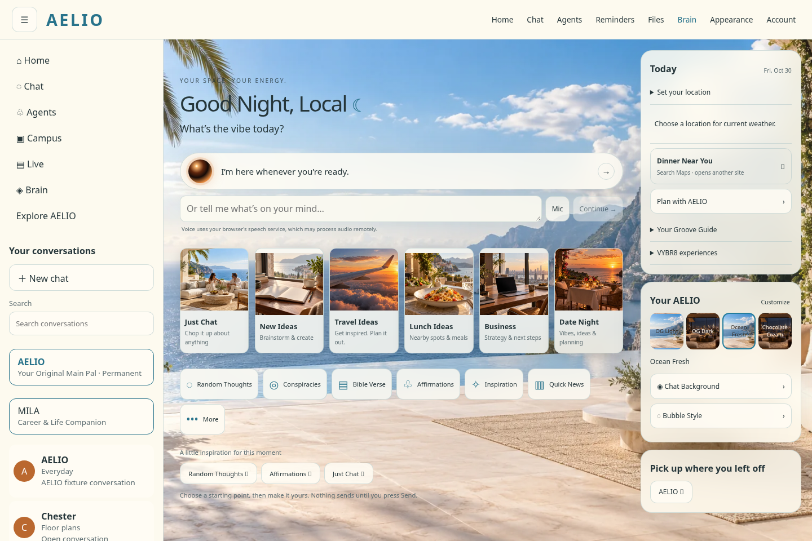
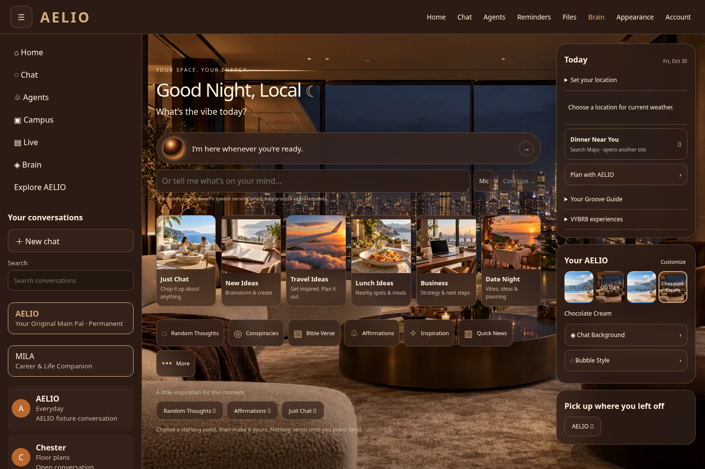
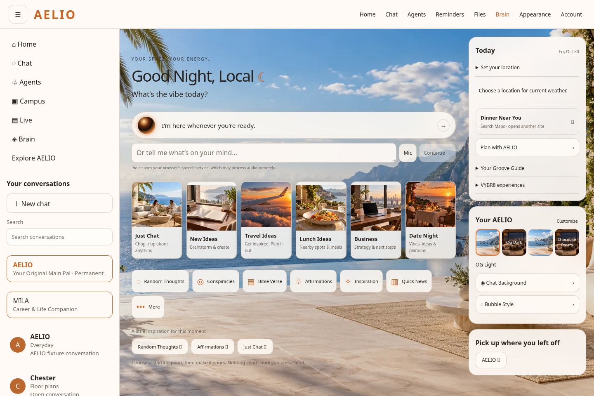
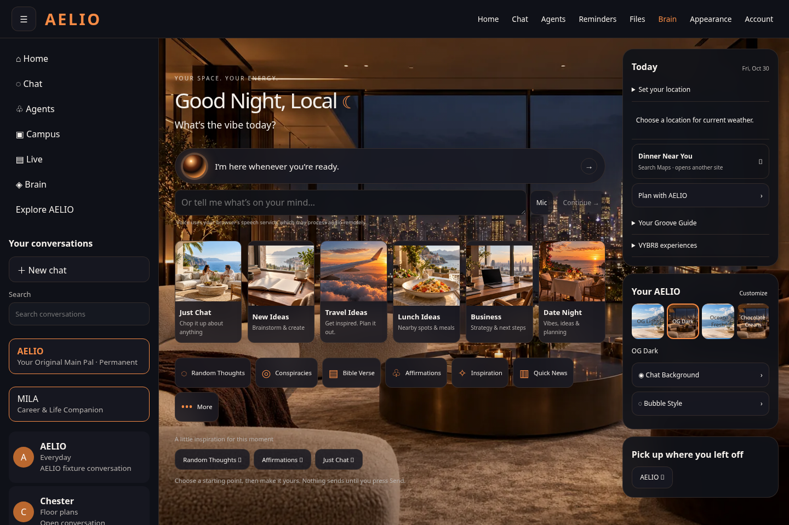
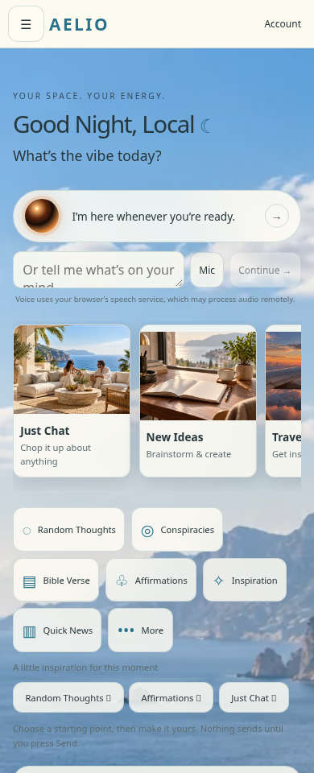

# AELIO v1.0.2 browser previews

Actual local Chromium captures of the implementation delivered in commit `a027bba`, using explicitly synthetic account/conversation fixtures. These are rendered application screenshots, not design mockups. Production Supabase, AI output, weather and connected services are not demonstrated. No preview deployment was created.

## Ocean Fresh — desktop

## Chocolate Cream — desktop

## OG Light — desktop

## OG Dark — desktop

## Ocean Fresh — mobile

This is the 390px viewport. Topic cards scroll horizontally; the Today and appearance panels continue below the captured viewport.

These review-only files were added after the immutable versioned delivery ZIPs. They do not change application code, configuration, SQL or the application version. Open this README on GitHub while signed in to the repository; the relative image links render directly there. The development branch remains separate from main.
