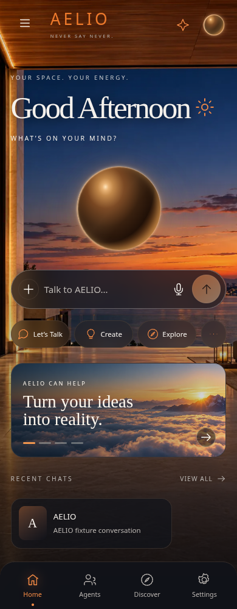
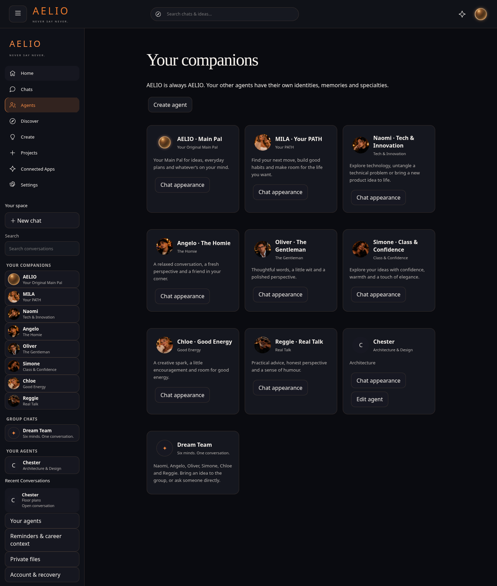
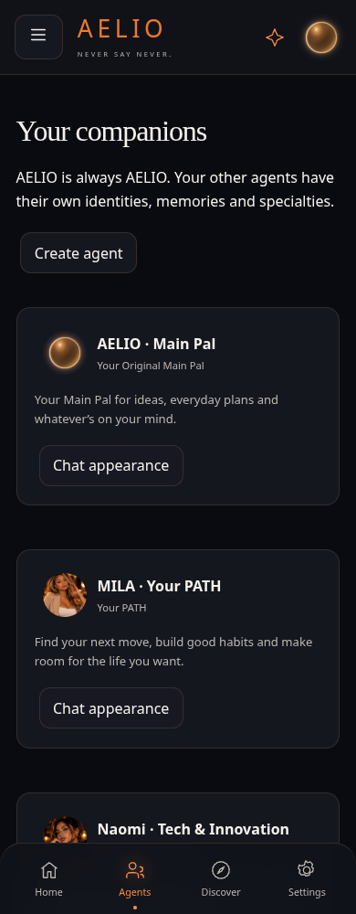
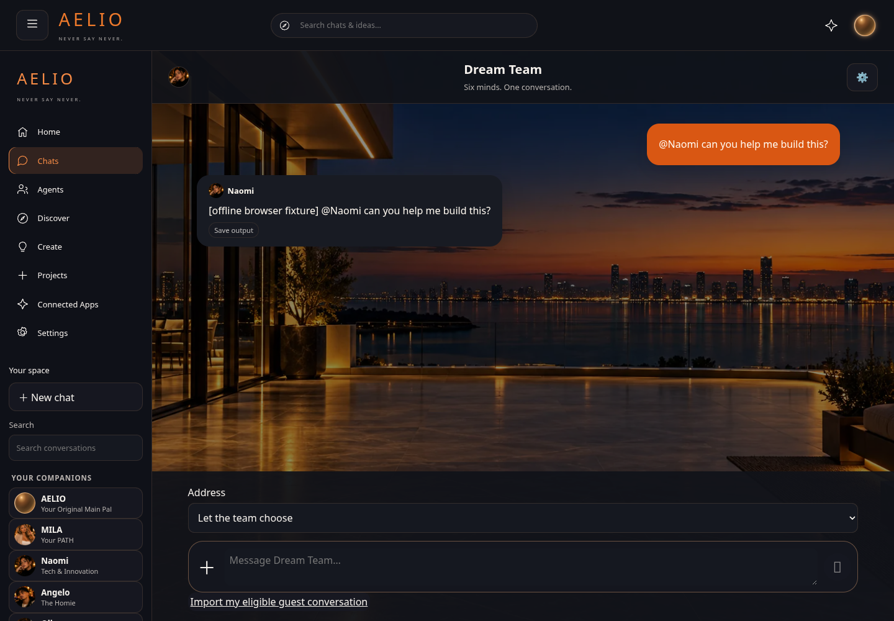
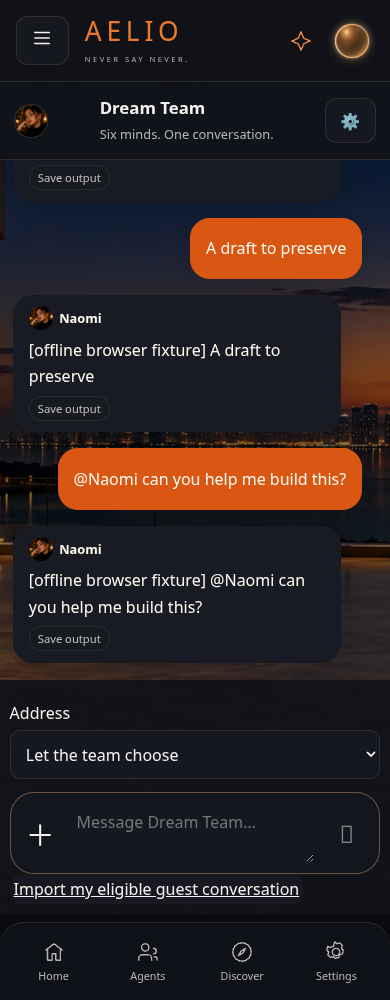
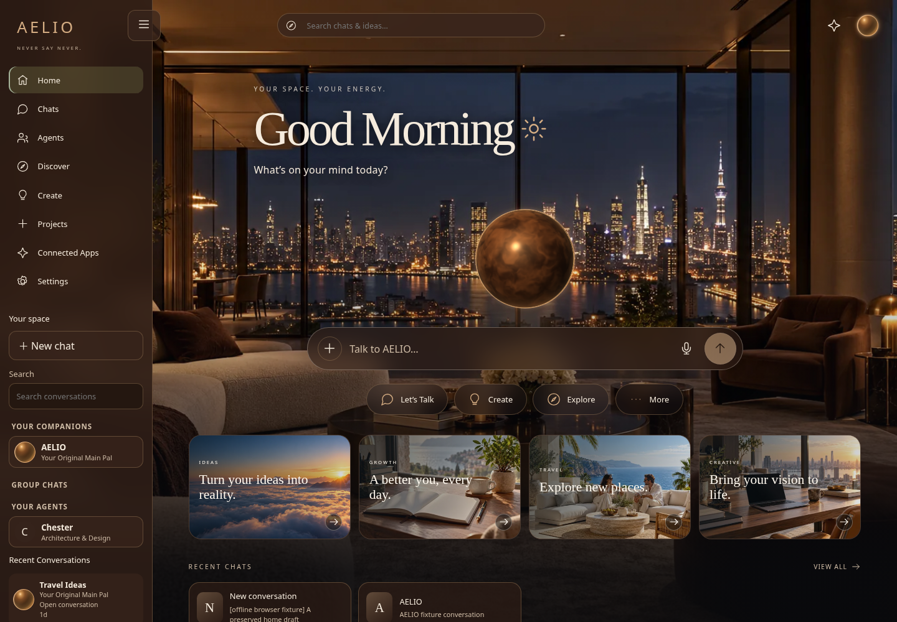
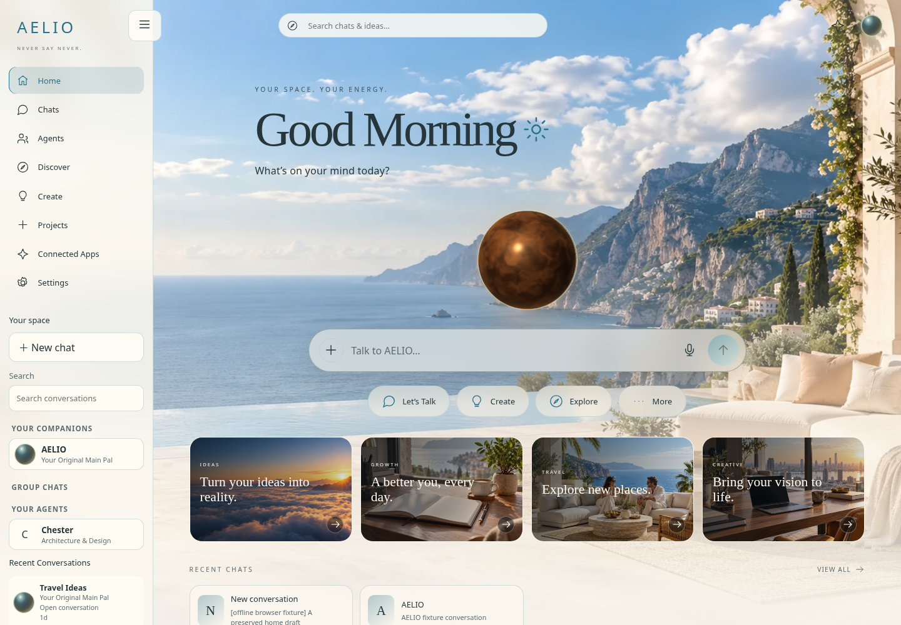

# AELIO 1.0.5 — migration branch preview

These are actual local browser renders of this code, using explicit synthetic account/history/provider fixtures. They are NOT a live Cloudflare deployment or proof of real authentication/inference. The demo account includes one synthetic custom agent, Chester, to verify that existing custom agents remain alongside the eight official companions and Dream Team. The permanent system itself creates eight agents and nine chats.

The supplied approved portrait sheet and business-casual MILA source are now installed without generation. Official portraits are locked; custom agents alone can upload/crop their own pictures.

Main remains unchanged. Review code on migration before approving a later main push. SQL 05/06 must be reviewed and applied manually before real-service acceptance.

## Home

## Companions

## Dream Team

The shown reply is synthetic browser-fixture text. Real routing and persistence were separately tested against disposable local PostgreSQL; actual provider output remains unverified.

## Theme refinement

