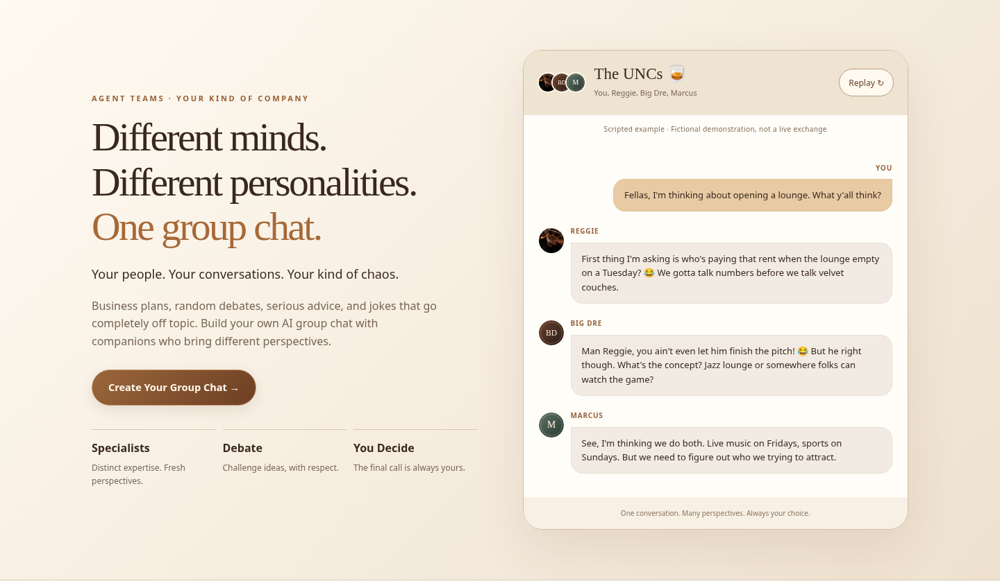
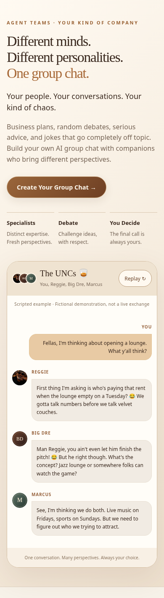
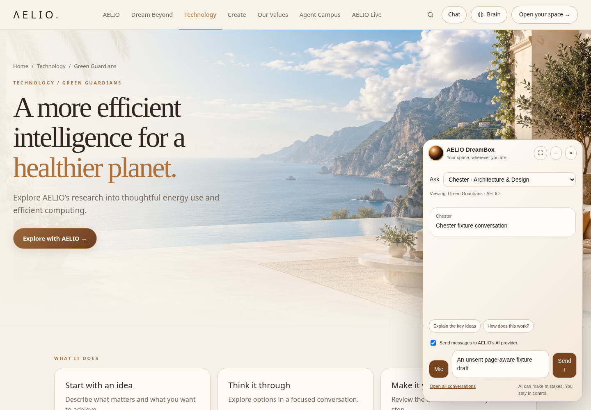
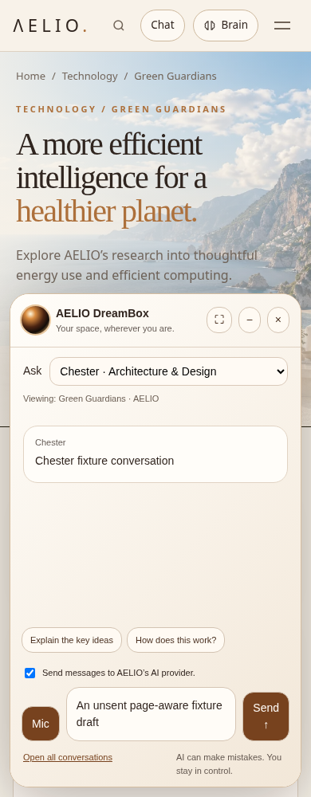
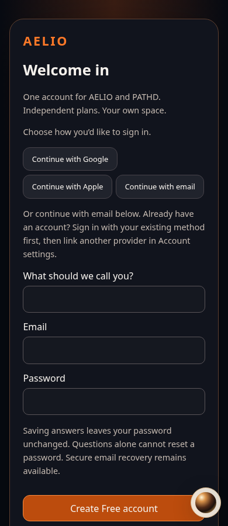

# AELIO 1.0.7 migration review

Main remains1.0.6. This is a source/screenshot preview, not a deployed preview URL. No production deployment or SQL performed. Screenshots render the real local build; DreamBox conversation text is explicitly synthetic test data, never proof of live inference.

The UNCs marketing exchange is the exact supplied scripted example. Big Dre/Marcus use distinct fictional monogram pictures; Reggie's approved portrait is preserved. No extra permanent agents are created.

See ../../releases/AELIO_v1.0.7_VALIDATION.md and ../../../config/V1_0_7_REVIEW_SETUP.md for tested behavior, required owner configuration, passkey limitations and SQL order. SQL09 does not grant founder/admin privileges; the separate owner-verified UUID credit-grant steps must be reviewed and run manually.

Latest priority is shared backend restoration. Resizable-sidebar/composer polish is explicitly deferred until that outage is verified resolved. Local pipeline tests pass; the live outage is not declared fixed without runtime logs/provider verification. Read the backend follow-up in the validation report before promoting this branch.
